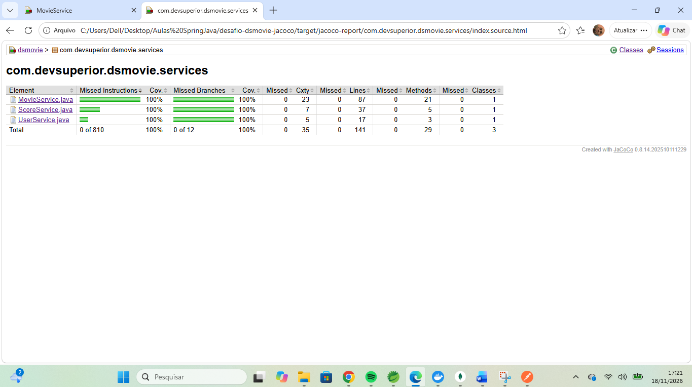

# DSMovie - Testes Automatizados, Cobertura JaCoCo e Versionamento de API

<p align="center">
  
  
  
  
  
</p>

API REST de filmes e avaliações (desafio da trilha **DevSuperior**), com foco em **qualidade de software**: testes unitários e de integração, cobertura medida pelo **JaCoCo** e **versionamento da API** com Spring HATEOAS e *Vendor Media Types*.

O código-base vem do desafio da DevSuperior. As evoluções deste repositório são próprias: a suíte de testes, a análise de cobertura, o versionamento da V1 e a documentação OpenAPI.

> **Uso de IA:** utilizei IA como ferramenta de investigação, análise, refatoração e construção dos testes. As sugestões foram avaliadas e confrontadas com o código e com os resultados das execuções, mantendo a validação técnica como parte do processo.

---

## 🎯 Objetivos do Projeto

* Construir uma suíte de testes **unitários** e de **integração** para a API.
* Usar o **JaCoCo** para encontrar cenários ainda não testados e ampliar a cobertura de forma incremental.
* Versionar a API (por URI e por *Vendor Media Type*) sem quebrar os contratos existentes.
* Documentar a API com **OpenAPI/Swagger**, com autenticação JWT.

---

## 🧪 Testes e Cobertura

### Suíte de testes

A execução mais recente no Eclipse registrou **48 testes aprovados, sem erros nem falhas**, distribuídos entre:

| Tipo | Classes de teste |
|---|---|
| **Unitários** (serviços, com Mockito) | `MovieServiceTests`, `ScoreServiceTests`, `UserServiceTests` |
| **Integração** (controllers, com Spring Boot Test) | `MovieControllerIT`, `MovieControllerV1IT`, `ScoreControllerIT` |
| **Contexto da aplicação** | `DsmovieApplicationTests` |

* Nos testes unitários, os repositórios são simulados com **Mockito** (`@Mock`, `@InjectMocks`), com verificações adicionais de chamadas (`verify`) nos fluxos de exclusão e persistência.
* Nos testes de integração, o comportamento dos endpoints é validado de ponta a ponta, incluindo o contrato da **V1** da API.

### Cobertura com JaCoCo

A análise de cobertura guiou a criação de novos testes. Ao revisar o relatório, surgiram fluxos condicionais, exceções e operações de DTO e de mapeamento de entidades ainda sem teste, que foram cobertos de forma incremental.

**Resultado:** 100% nas métricas do JaCoCo (instruções, branches, linhas e métodos). Como exemplo, a classe `MovieService`, a última a ser fechada, registra:

| Métrica | Resultado |
|---|---|
| Instruções | **547 de 547** (100%) |
| Branches | **4 de 4** (100%) |
| Linhas | **87 de 87** (100%) |
| Métodos | **21 de 21** (100%) |

> **Nota:** cobertura mede o código que foi executado pelos testes, não a qualidade das asserções. Por isso os testes verificam também os resultados e as interações, e não apenas passam pelas linhas.




   Relatório JaCoCo (docs/jacoco-total.png)   (dsmovie/target/jacocoreport/index.html)

**Como gerar o relatório:**

```bash
./mvnw clean verify
# Relatório: target/jacoco-report/index.html
```

---

## 🔖 Versionamento da API

A **V1** foi construída em etapas, com decisões documentadas no histórico de commits:

1. **Versionamento por URI com HATEOAS:** primeira versão da V1, com `MovieGenreDTO`.
2. **Versionamento por *Vendor Media Type*** (`application/vnd...+json`) para filmes e avaliações, negociado por `Accept` e `Content-Type`.
3. **Integração dos três conceitos** (OpenAPI/Swagger, HATEOAS e versionamento) no mesmo projeto, o que gerou incompatibilidades que não apareciam quando cada conceito era estudado isoladamente.

### Problemas enfrentados
* O **Jackson** não conseguia serializar/desserializar corretamente alguns endpoints versionados, na combinação entre DTOs que estendem `RepresentationModel` e o *Vendor Media Type*.
* Ajuste da configuração das requisições de escrita (`POST` e `PUT`) e entendimento da diferença entre `Accept` e `Content-Type`.

### Decisão: manter HATEOAS na V1 ou simplificar?
* **Manter HATEOAS na V1:** abordagem mais uniforme entre os endpoints, mas exigiria mais investigação e ajustes.
* **Simplificar a V1 com DTOs puros (escolha adotada):** reduz os pontos de incompatibilidade e deixa o contrato mais claro, abrindo mão dos links hipermídia nessa versão.

O resultado foi a separação dos DTOs da V1 (ex.: `MovieV1DTO`), sem dependência das estruturas HATEOAS, ajustes no mapeamento de dados e relacionamentos por identificadores, alinhamento dos conversores de mensagens e dos headers `Accept` e `Content-Type`, e endpoints versionados funcionando sem afetar as demais rotas.

---

## 📚 Documentação OpenAPI / Swagger

* DTOs documentados com `@Schema` e descrições detalhadas.
* Configuração do **Spring Security no Swagger**, que permite testar endpoints protegidos com **JWT Bearer** direto na interface.
* **Swagger UI (local):** `http://localhost:8080/swagger-ui/index.html` (com a aplicação em execução)

<!-- TODO: se publicar a documentação em outro lugar (ex.: Readme.com), acrescente o link aqui. -->

---

## 🛠️ Tecnologias Utilizadas

* **Java 21** e **Spring Boot 3.x**
* **Spring Data JPA**, **Spring Security**, **Spring HATEOAS**
* **JUnit 5**, **Mockito** e **Spring Boot Test**
* **JaCoCo** (cobertura de código)
* **SpringDoc** (OpenAPI 3 / Swagger UI)
* **Maven** (Maven Wrapper)
* **Spring Tool Suite (Eclipse)** | Windows 11
* **Git e GitHub**, com mensagens de commit semânticas (`feat`, `test`, `docs`)

---

## 🕒 Evolução do Projeto

| Período | Etapa |
|---|---|
| Ago/2026 | Testes unitários de `UserService` e `ScoreService`, com verificações adicionais do Mockito |
| Out/2026 | Documentação OpenAPI: `@Schema` nos DTOs e configuração de segurança do Swagger |
| Nov/2026 (início) | Versionamento da API: URI com HATEOAS e *Vendor Media Types* para filmes e avaliações |
| Nov/2026 | Suíte de integração `MovieControllerIT` e `MovieControllerV1IT`, e correção do mapeamento de gêneros |
| Nov/2026 | Testes de `MovieService` para os endpoints V1 e de gênero, alcançando 100% de cobertura no JaCoCo |

---

## ⚙️ Como Executar

**Pré-requisitos:** JDK 21.

```bash
# 1. Clonar o repositório
git clone https://github.com/J3f3r/desafio-dsmovie-jacoco.git
cd desafio-dsmovie-jacoco

# 2. Executar os testes e gerar o relatório de cobertura
./mvnw clean verify

# 3. Executar a aplicação
./mvnw spring-boot:run
```

<!-- TODO: se a aplicação exigir variáveis de ambiente ou um perfil específico (ex.: test), descreva aqui. -->

---

---

## ✨ Próximos Passos

* **Deploy:** preparar o `Dockerfile` para ambiente de produção.
* **Testes:** ampliar os testes de API e recompor a cobertura do JaCoCo após os novos incrementos.

---
## 👤 Autor

**Jeferson Martins** - Desenvolvedor Backend Java Júnior
[LinkedIn](https://www.linkedin.com/in/jefersonmartins-48b9b690) | [GitHub](https://github.com/J3f3r)